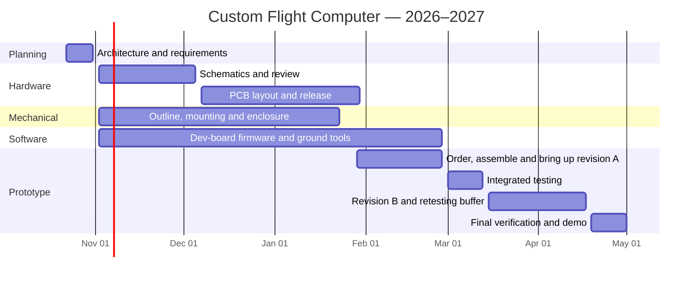

# Flight Computer Roadmap

**Goal: Tested core prototype by April 30, 2027.**  
Dates assume 4–6 active contributors at roughly 3–5 hours per week each, with lighter workloads around exams and holidays. Flight readiness is a separate milestone after testing.

## Timeline

**Main checkpoints:** Oct 30 → architecture · Dec 4 → schematic review · Jan 29 → order · Feb 26 → boards working · Mar 12 → integrated test · Apr 30 → demonstration

## 1. Architecture — Due October 30

- [ ] Agree on the first prototype's required functions.
- [ ] Select initial MCU, sensors, GPS, radio, and storage components.
- [ ] Define batteries, voltage rails, and backup-system responsibilities.
- [ ] Agree on board dimensions, mounting holes, connectors, and interfaces.
- [ ] Assign an owner and reviewer to each subsystem.
- [ ] Confirm budget and order development hardware.

**Done when:** The team has one agreed block diagram and an initial interface/pin table. Resolve conflicting battery and interface notes before design release.

## 2. Schematics and Mechanical Design — Review December 4

**Electrical — initial designs by November 20**

- [ ] Draft power, control, and communication schematics.
- [ ] Build the BOM and check component availability.
- [ ] Verify pin assignments, power budget, footprints, and debug/test access.

**Mechanical — in parallel**

- [ ] Define board outline, holes, spacing, and component-height limits.
- [ ] Design enclosure, battery mounting, and cable routing.
- [ ] Check connector access, antenna placement, and pressure-sensor venting.
- [ ] Make a fit mock-up and review it with electrical.

**Done when:** Schematics and shared mechanical interfaces pass team review. Mechanical defines the board envelope; electrical verifies component footprints.

## 3. PCB Layout — Order by January 29

- [ ] Complete placement and routing by January 22.
- [ ] Check electrical/design rules and explain exceptions.
- [ ] Verify footprints, connector orientation, and 3D enclosure fit.
- [ ] Review manufacturing files, BOM, cost, and assembly plan.
- [ ] Approve and order revision A by January 29.

**Done when:** Another teammate reviews the release package and all critical findings are closed.

**Schedule allowance:** Reduced work during holidays/exams; confirm the team's actual availability.

## 4. Software — Start November 2; Continue Through Testing

- [ ] Set up a reproducible build, flash, and debug process.
- [ ] Test sensors on development boards.
- [ ] Implement timestamped logging and basic telemetry/ground reception.
- [ ] Define flight states and replay tests using simulated or recorded inputs.
- [ ] Port drivers to custom hardware during bring-up.

**Done when:** The custom stack records usable data and sends it to the ground receiver, with documented error handling.

**Keep optional:** Payload modules, automatic module discovery, and a polished dashboard...

## 5. Assembly and Bring-Up — Due February 26

- [ ] Inspect assembly, polarity, connectors, and shorts before power-on.
- [ ] Power each board individually using a current-limited supply.
- [ ] Measure rails/current and confirm programming access.
- [ ] Test one peripheral at a time.
- [ ] Record board revisions, firmware commits, and issues.

**Done when:** Each board operates independently and is ready to join the stack.

**Schedule allowance:** Budget 2–4 weeks for procurement, fabrication, shipping, and assembly; verify supplier timing before ordering.

## 6. Integration and Revision Decision — Due March 12

- [ ] Run sensors, logging, GPS, and telemetry together.
- [ ] Test battery operation and peak loads.
- [ ] Test missing sensors, lost communication, resets, and interrupted power.
- [ ] Replay flight states and measure deployment outputs using inert loads.
- [ ] Check enclosure fit, wiring retention, and service access.

**Done when:** The core works end to end and every failure has a documented result and owner.

**Decision:** Identify changes required for revision B by March 12.

## 7. Revision B and Retesting — Due April 16

- [ ] Fix verified hardware defects; order by March 19 if needed.
- [ ] Assemble corrected boards and repeat affected tests.
- [ ] Repeat the full core checklist on the integrated build.

**Done when:** Critical defects are resolved. If no respin is needed, use this time for longer tests and reliability improvements.

## 8. Verification and Demonstration — Due April 30

- [ ] Run a full-duration test with logging and telemetry active.
- [ ] Demonstrate recovery from defined faults.
- [ ] Complete agreed mechanical/environmental checks.
- [ ] Save test evidence, operating instructions, and remaining issues.
- [ ] Demonstrate the core prototype to the team.

**Done when:** Another teammate can reproduce the demonstration using the documentation.

**Next milestone:** Developmental flight only after a separate readiness review. Energetic testing requires its own procedure and responsible club personnel.

## Simple GitHub Tracking

### One shared project board

Use five columns:

| Backlog | Ready | In Progress | In Review | Done |
| --- | --- | --- | --- | --- |
| Future work | Defined and unblocked | Someone is working on it | Needs review or test evidence | Acceptance criteria met |

Mark blocked work with a `blocked` label and a comment naming the dependency. Keep it in its current column so its progress remains visible.

### One issue per deliverable

Use short, specific titles: **“Review power-board schematic”** or **“Log IMU samples to SD card.”**

Each issue needs:

- **Owner:** One accountable person.
- **Milestone:** Which phase deadline it supports.
- **Done when:** A short acceptance checklist.
- **Dependencies:** Links to issues that must finish first.
- **Evidence:** Pull request, CAD review, test log, or screenshot.

Keep tasks small enough for about one week of student work. Link pull requests to their issues.

### Labels and milestones

**Area labels:** `hardware`, `mechanical`, `firmware`, `testing`, `docs`  
**Extra label:** `blocked`

Create milestones matching the eight phases above; track software issues under the delivery milestone they support rather than giving all software one distant deadline.

### Weekly visibility

- Spend 10 minutes each week updating the board before the team meeting.
- Review blockers and upcoming milestone work first.
- Keep one pinned **Weekly Status** issue: completed, next, blockers, decisions needed.
- Link this roadmap and the project board from the repository README.
- Close issues only when their acceptance criteria are met.

Keep the roadmap for phase dates, issues for individual tasks, and the project board for current status.
