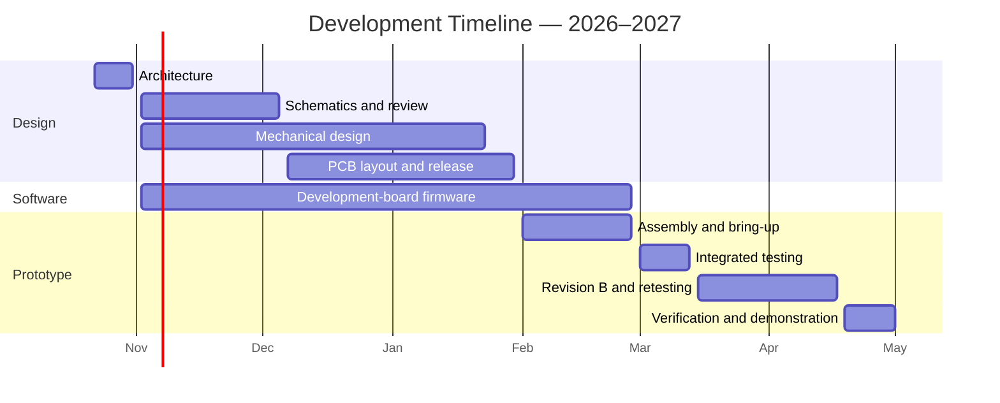

# Custom Flight Computer

A modular flight computer project by the **Milwaukee School of Engineering High Power Rocket Club Avionics team**, being developed for future club flights and **IREC 2028**.

Our goal is to build a customizable flight computer that gives the team more control over its electronics and flight data. The design centers on a core board stack, with additional modules planned to extend its capabilities.

## Start Here

| I need to… | Go to |
| --- | --- |
| Find my assignment | [Block assignments](Docs/Blocks/README.md) |
| Set up my computer | [Setup](Docs/SETUP.md) |
| Learn how to submit work | [Team workflow](CONTRIBUTING.md) |
| Find datasheets and tutorials | [Resources](Docs/Resources.md) |
| Understand the system | [Hardware architecture](Docs/Architecture/HardwareArchitecture.md) |
| Check current requirements | [Requirements](Docs/Requirements.md) |

## Project Timeline

**Target: Tested core prototype by April 30, 2027.** Dates are planning targets and include time for exams, holidays, and a possible second PCB revision. Flight readiness will be reviewed separately.

### Checkpoints

| Target Date | Checkpoint |
| --- | --- |
| October 30, 2026 | Agree on architecture, components, interfaces, and owners |
| December 4, 2026 | Complete schematic and mechanical interface review |
| January 29, 2027 | Approve and order revision A PCBs |
| February 26, 2027 | Complete assembly and individual board bring-up |
| March 12, 2027 | Demonstrate integrated operation; decide revision B changes |
| April 16, 2027 | Complete revision B and retesting, if needed |
| April 30, 2027 | Verify and demonstrate the core prototype |

## Project Goals

- Collect and store flight data for analysis and future club projects.
- Support GPS tracking and radio telemetry.
- Develop custom parachute deployment electronics alongside an off-the-shelf backup flight computer.
- Use a modular board stack that can support additional payload and sensor modules.
- Develop an easy-to-read digital dashboard for flight data.

These are intended capabilities; implementation and testing are still ahead.

## Project

The proposed core has power, control, and communication boards. Planned functions include flight sensing, microSD logging, GPS, telemetry, and pyro-channel control alongside a commercial backup system.

**Next checkpoint:** Agree on block interfaces, owners and initial schematic assignments. The working roadmap targets a tested core prototype in April 2027; leads should confirm dates against team availability. Flight readiness is a separate review.

## Repository

| Folder | Contents |
| --- | --- |
| [Hardware](Hardware/README.md) | KiCad files and hardware working instructions |
| [Software](Software/README.md) | Software planning and future firmware |
| [3DModels](3DModels/README.md) | Mechanical CAD |
| [Docs](Docs/README.md) | Requirements, architecture, assignments and resources |
| [Tests](Tests/README.md) | How to record testing when it begins |

## Contributing

Use issues to track assignments and pull requests to review changes. See [CONTRIBUTING.md](CONTRIBUTING.md).

## License

This repository is licensed under the [MIT License](LICENSE).